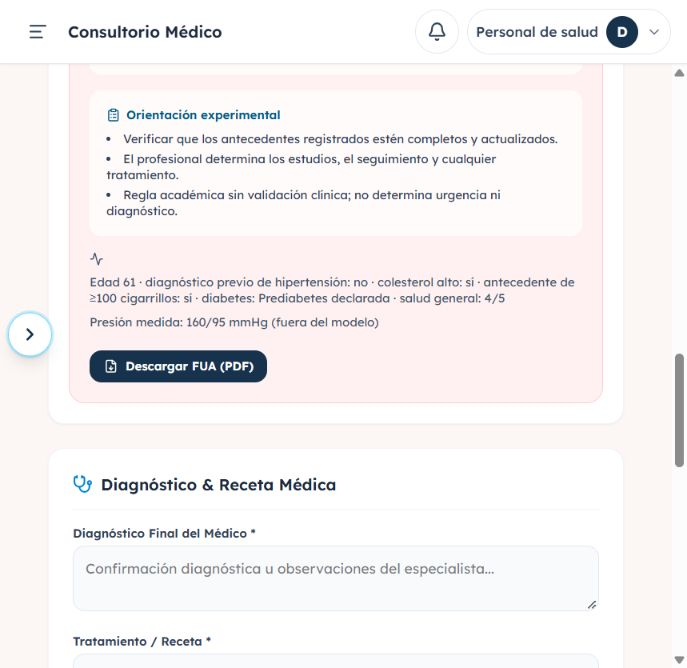

> Actualización posterior: el candidato se integró como v3.0.0. Este informe conserva el estado al cerrar su etapa; ver [estado vigente de integración](INTEGRACION_V3_Y_GENERALIZACION.md).

# Ajustes y validación — 15/10/2026

Se implementó la primera etapa de alineación académica: contrato de entrada, interpretación de resultados, conservación de datos originales y documentación. El modelo entrenado y su metadata permanecen sin cambios. La revisión previa se conserva en [REVISION_ACADEMICA_2026-10-15](REVISION_ACADEMICA_2026-10-15.md).

## Cambios implementados

- La interfaz y el PDF muestran un índice sobre 100 derivado del score no calibrado. Explican que la clasificación se asocia con antecedentes autodeclarados y no constituye pronóstico futuro, diagnóstico ni criterio de urgencia. Se conserva el nombre API `probabilidad` para compatibilidad.
- Los nueve predictores son obligatorios. La API comprueba edad adulta entre 18 y 120 años y coincidencia con la fecha de nacimiento del paciente, usando la fecha de Lima.
- Se conserva la categoría original de diabetes y la presión medida. La prediabetes se mantiene al editar; un positivo histórico sin categoría exige confirmar el detalle en el formulario. Las mediciones de presión no inventan un diagnóstico previo de hipertensión ni ingresan como features adicionales al modelo.
- La migración aditiva 003 agrega tres columnas opcionales. Su ejecutor puede repetirse y no recalcula ni modifica resultados históricos. Los clientes anteriores pueden seguir enviando el booleano de diabetes sin categoría.
- Las reglas nuevas ofrecen orientación experimental y dejan las decisiones clínicas al profesional. Los antecedentes visibles son respuestas del formulario, no explicaciones causales del modelo. Los textos históricos persistidos se conservan con una advertencia.
- Se actualizaron README, integración, model card, documentación del modelo, mapa del proyecto, rutas, PDF y colección Postman. Los documentos extensos reemplazados se guardaron en [historico](historico/). Se corrigió la interpretación de la figura de calibración y su generador.
- El PDF distingue antecedentes, mediciones y orientación; se ajustaron encabezados, saltos y firmas para evitar superposiciones.

## Verificaciones ejecutadas

| Comprobación | Resultado |
| --- | --- |
| Suite completa del backend | **99 pruebas aprobadas**, 45 advertencias de dependencias |
| Pruebas del frontend (`npm test`) | **4 pruebas aprobadas** |
| Frontend (`npm run lint`, `npm run build`) | Correctos |
| Contrato HTTP y persistencia | Omisiones, edades inválidas, discrepancias con nacimiento, categorías y presiones inconsistentes rechazadas; evaluación válida conservada |
| Compatibilidad | Cliente con booleano histórico y textos persistidos cubiertos por pruebas |
| Migración | Aplicada a MySQL local; segunda ejecución correcta sin cambios; prueba de conservación del historial |
| Modelo real | Métricas recalculadas coinciden con metadata: ROC AUC 0.8403, AP 0.3537, F1 0.3588 y recall 0.8192 a umbral 0.50 |
| Navegador y MySQL | Inicio de sesión, evaluación nueva, consulta del resultado y lectura de datos originales verificados |
| PDF | Descarga desde el consultorio comprobada; revisión visual de las cinco páginas de tres casos: prediabetes, banda alta e histórico |

La comprobación en navegador creó la evaluación **43** del paciente de demostración Juan Pérez: prediabetes, presión medida 160/95, antecedente de hipertensión `false`, score 0.747856 y versión 2.0.0. Se verificó la misma información en MySQL y en el consultorio. Este registro es evidencia funcional de la demo; no representa una validación clínica.

El artefacto `modelo_cardiaco.joblib` conserva su hash Git `b49eeefaf0961762671588d39fe3ef9f0fa776db`; no hubo reentrenamiento. Las advertencias observadas incluyen deprecaciones de `python-jose` y una incompatibilidad de información de versión entre el entorno instalado de bcrypt y passlib; el inicio de sesión funcionó. Los requisitos ya fijan una versión compatible de bcrypt.

## Segunda etapa: pendiente al cierre de esta primera entrega

**Actualización:** la segunda etapa ya se implementó y ejecutó después. Ver [resultados y pendientes actuales](SEGUNDA_ETAPA_EXPERIMENTAL.md). La lista siguiente conserva el alcance pendiente al terminar la primera etapa:

Los cambios anteriores corrigen el funcionamiento del contrato y lo que el proyecto comunica. No resuelven las limitaciones experimentales del entrenamiento:

1. Elegir umbrales en validación y reservar un test independiente para su evaluación final.
2. Medir sensibilidad a perfiles repetidos entre train y test, sin asumir que perfiles iguales corresponden a la misma persona.
3. Añadir baseline sencillo, intervalos de incertidumbre y evaluación por subgrupos de edad y sexo.
4. Evaluar calibración si se pretende comunicar probabilidades y definir versionado reproducible de artefactos y reglas antes de reentrenar.

La ausencia de validación clínica y local sigue siendo una limitación explícita. El detalle científico vigente está en [MODELO_ML](MODELO_ML.md) y [MODEL_CARD](MODEL_CARD.md).
