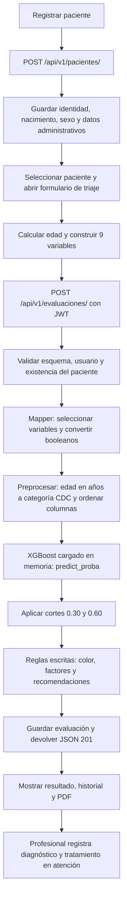

**Revisión del ML de HealthCure / CardioPredict — 15 de octubre de 2026**

La integración técnica funciona y hay aprendizaje supervisado real. El proyecto es defendible como prototipo académico que calcula un puntaje asociado a antecedentes cardiovasculares declarados. La evidencia disponible todavía no demuestra que sus colores, plazos y recomendaciones sean un triaje clínico válido. Hay diferencias concretas entre lo que aprende el modelo, lo que captura el formulario y lo que comunica la aplicación.

Se revisaron el código de entrenamiento, el artefacto configurado, su metadata, los formularios React, las capas de la API, la persistencia, las recomendaciones y los experimentos guardados. Se ejecutaron las 76 pruebas existentes y se recalcularon las métricas del modelo activo sobre su partición de test original. No se modificaron el modelo, las reglas, los datos de pacientes ni el código funcional.

**1. Qué modelo utiliza realmente la aplicación**

- Ruta configurada: `app/resources/modelo_cardiaco.joblib`.
- Algoritmo comprobado: `XGBClassifier`, versión declarada `2.0.0`.
- Entrenamiento declarado: 9 de octubre de 2026; 253 680 filas de BRFSS 2015 transformado en Kaggle.
- 9 variables; 400 árboles, profundidad máxima 3, tasa de aprendizaje 0.05.
- `scale_pos_weight=9.62`.
- Cortes de la aplicación: `<0.30` bajo, `0.30–<0.60` moderado, `>=0.60` alto.
- El umbral 0.7026 de la ficha técnica NO se utiliza para esos tres niveles.

Se comprobaron los SHA-256 del CSV, modelo y metadata contra `experimentos_ml/segunda_etapa_20261015_final/protocolo.json`: coinciden. Los candidatos calibrados de esa carpeta no están desplegados por la configuración actual.

**2. Flujo completo de un paciente**



1. **Registrar paciente no ejecuta ML.** `frontend/src/pages/PacientesPage.jsx:166` construye los datos administrativos y llama al servicio de pacientes. `app/services/paciente_service.py:82` valida duplicados y ubicación y guarda el registro. Fecha de nacimiento, sexo, peso y talla existen en el registro, pero el predictor no recibe directamente todo ese objeto.
2. **Abrir triaje.** `frontend/src/pages/TriajePage.jsx:162` selecciona al paciente. `ModalTriaje.jsx` precarga peso/talla y, si está disponible en la página, su última evaluación. El formulario calcula la edad y bloquea menores de 18 años en la interfaz.
3. **Construir el request.** `frontend/src/utils/triaje.js:97` envía `paciente_id`, edad en años y ocho variables adicionales. Presión alta se calcula como diagnóstico previo O lectura elevada. Prediabetes y diabetes se agrupan en `true`. Los otros signos vitales y campos complementarios del modal no viajan en ese request.
4. **Autenticar y validar.** `app/api/v1/evaluaciones.py:40` recibe el POST; Pydantic valida tipos/rangos y la dependencia valida JWT/usuario activo. El servicio verifica que el paciente exista. No recalcula su edad desde la fecha de nacimiento ni comprueba que coincida con el valor recibido.
5. **Mapear.** `app/mappers/evaluacion_mapper.py:59` extrae exclusivamente las 9 variables; convierte `true/false` en `1/0`. DNI, nombres, seguro y localidad no son predictores.
6. **Preparar el vector.** `app/ml/preprocessor.py:83` verifica presencia de variables y rangos; convierte, por ejemplo, 55 años en categoría CDC 8 y construye un DataFrame de una fila con el orden esperado.
7. **Inferir.** `app/ml/predictor.py:24` obtiene el modelo mediante el cargador; la primera vez se deserializa el `.joblib` y después se reutiliza en memoria por proceso. Ejecuta `predict_proba(df)[0][1]`. En cada consulta se predice; no se reentrena.
8. **Clasificar.** `app/ml/predictor.py:74` lee los cortes de la metadata. El modelo aprendió dos clases; los tres colores son una discretización posterior definida por el producto.
9. **Generar textos.** `app/mappers/evaluacion_mapper.py:168` llama a `generar_triaje_clinico`. `app/services/evaluacion_triaje_service.py:71` contiene textos fijos según la banda. Los factores se enumeran por reglas sobre los datos de entrada.
10. **Persistir y responder.** Se guardan variables, resultado, versión, autor, fecha y textos del triaje. El repositorio hace `flush` y `get_db()` gestiona commit/rollback. El endpoint devuelve JSON con estado 201. Si falla ML, devuelve error 500 y no se crea una evaluación exitosa.
11. **Mostrar y atender.** `TriajePage.jsx:139` muestra el resultado y actualiza las listas. La tarjeta permite descargar el FUA; consultorio registra una atención vinculada opcionalmente a la evaluación. Ese diagnóstico no se utiliza automáticamente para actualizar el modelo ni para medir su desempeño.

**Ejemplo ejecutado con el modelo activo**

Paciente de 55 años, hipertensión, colesterol alto y diabetes; activo físicamente, sin tabaquismo, sin ACV, salud general 3 y sin dificultad para caminar:

```text
Vector para XGBoost: [8, 1, 1, 0, 1, 0, 1, 3, 0]
Salida: 0.513150
Clasificación: moderado
Color: amarillo
Texto escrito en reglas: consulta de control en 15 a 30 días
Versión: 2.0.0
```

El 0.513150 lo calcula XGBoost. El color y el plazo de 15 a 30 días los decide el código de reglas. No son resultados aprendidos del dataset ni evidencia de que ese plazo sea apropiado para ese paciente.

**3. Qué está bien implementado**

- Hay un modelo real y su inferencia funciona tanto directamente como mediante la API en las pruebas existentes.
- Entrenamiento e inferencia utilizan las mismas 9 columnas y el mismo orden. La conversión de edad corrige una fuente importante de errores.
- El entrenamiento compara Random Forest y XGBoost mediante validación cruzada estratificada y reserva un conjunto de test.
- Se reportan ROC AUC y average precision, además de accuracy. La ponderación de clases es una técnica válida que exige decidir y evaluar sus efectos.
- Se separan carga, preprocesamiento, predicción, reglas, API y persistencia.
- Se conservan los inputs y resultados por evaluación. El modelo se reutiliza en memoria y no se carga desde disco en cada solicitud.
- La tarjeta principal aclara que muestra un índice y que no confirma enfermedad.
- Hay model card y experimentos posteriores que reconocen varias limitaciones.

**4. Resultados que pude reproducir**

Se reconstruyó el split original: 80/20, estratificado, `random_state=42`. Se cargó el artefacto existente; no se reentrenó. El test contiene 50 736 registros y 4 779 positivos.

| Medida | Valor reproducido | Interpretación |
|---|---:|---|
| ROC AUC | 0.840309 | Hay capacidad de ordenar positivos y negativos; no significa 84% de aciertos |
| Average precision | 0.353719 | Supera el baseline aproximado de prevalencia 0.0942; el código la llama PR AUC |
| Brier del modelo | 0.171428 | Error de las probabilidades; menor es mejor |
| Brier de prevalencia constante | 0.085321 | El modelo activo es peor que este baseline como pronosticador probabilístico según Brier |
| Recall con corte 0.50 | 81.92% | Este corte NO define los colores de la aplicación |
| Precision con corte 0.50 | 22.97% | Muchos positivos predichos no tienen la etiqueta positiva del dataset |

El Brier combina calibración y discriminación: no conviene usarlo como prueba aislada de calibración. Las diferencias entre puntaje medio y frecuencia positiva por banda también muestran una sobreestimación marcada:

| Banda de la app | Registros | Positivos reales del dataset | Fracción positiva | Puntaje medio |
|---|---:|---:|---:|---:|
| Bajo | 25 929 | 388 | 1.50% | 11.24% |
| Moderado | 12 220 | 972 | 7.95% | 45.87% |
| Alto | 12 587 | 3 419 | 27.16% | 75.12% |

Si se considera positivo solo `alto`, se recupera el 71.54% de las etiquetas positivas y se alerta al 24.81% del test. Si se considera positivo `moderado + alto`, el recall sube a 91.88%, pero se alerta al 48.89% de las personas y la precision es aproximadamente 17.70%. Hay 388 positivos dentro de `bajo`: 8.12% de todos los positivos, no 8.12% de todos los pacientes de esa banda.

Son resultados retrospectivos sobre la etiqueta de una encuesta. No miden urgencias, eventos futuros, beneficio clínico, ni desempeño en pacientes peruanos.

**5. Hallazgos prioritarios**

**A. El objetivo aprendido no valida el uso clínico propuesto. Prioridad alta.**

El target `HeartDiseaseorAttack` representa antecedentes declarados de enfermedad coronaria o infarto. La documentación del CDC describe `_MICHD` como haber reportado CHD o MI alguna vez. No es una etiqueta de urgencia actual, un diagnóstico confirmado independiente ni un evento cardiovascular futuro con horizonte temporal.

Sin embargo, las reglas indican ECG inmediato, evaluación por cardiología, plazos de seguimiento y evaluación de ajustes de tratamiento. El dataset no valida esas acciones. Además, los síntomas actuales, ECG y varios signos vitales no intervienen en la decisión. Por inspección del flujo, cambiar un dato que no se envía al backend no puede modificar la predicción ni la banda.

Acción: definir el alcance como puntaje experimental de apoyo a revisión de antecedentes, o validar un objetivo clínico específico con datos y profesionales apropiados. Si el producto requiere triaje agudo, diseñar y validar esa decisión explícitamente; no derivarla solo de este clasificador.

**B. Se siguen mostrando probabilidades no calibradas. Prioridad alta.**

`TarjetaTriaje.jsx:74` utiliza correctamente “Índice de riesgo”. Pero `frontend/src/pages/ConsultorioPage.jsx:207` muestra `%` y `app/services/reporte_service.py:326` escribe literalmente “Probabilidad: ...%”. La API también denomina el campo `probabilidad`.

La ponderación aumenta el peso de los positivos y altera la escala aprendida; llenar colores no valida esa escala. Que el grupo alto tenga puntaje medio 75.12 y frecuencia positiva 27.16% ilustra el problema.

Acción inmediata: unificar el significado y las etiquetas en pantalla, PDF y contrato. Para ofrecer probabilidades, evaluar calibración independiente y su traslado a la población objetivo. No sustituir el modelo por el calibrado conservando automáticamente 0.30/0.60.

**C. Una entrada cambia de significado entre entrenamiento e inferencia. Prioridad alta.**

La presión alta de BRFSS proviene de haber sido informado por un profesional de que se tiene hipertensión. El frontend envía `hipertensionPrevia || esPresionElevada(lectura)` en `frontend/src/utils/triaje.js:101`. Una lectura aislada puede activar la misma variable aunque no exista ese antecedente.

El backend solo recibe el booleano y no conserva la lectura ni su procedencia. En reevaluaciones, ese booleano puede precargarse como “diagnóstico previo de hipertensión”, aunque se originara únicamente en una lectura anterior.

Acción: separar antecedente diagnosticado y medición actual, conservar su procedencia y alimentar al predictor con la definición que realmente aprendió. Cualquier definición nueva debe validarse.

**D. Datos omitidos se interpretan como respuestas clínicas. Prioridad alta.**

`app/schemas/evaluacion.py:58` exige edad, pero los siete booleanos tienen default `False` y salud general default 3. Se comprobó que `EvaluacionCreate(paciente_id=1, edad=55)` se acepta y completa todos esos valores. La validación de presencia del preprocesador ya no distingue un dato omitido de una respuesta “no”. El formulario también parte de casillas desmarcadas.

Acción: exigir respuestas explícitas para todos los predictores; diferenciar desconocido de no. Si se incorpora desconocido al modelo, diseñar su tratamiento con datos adecuados. No basta con aceptar `null` y reemplazarlo silenciosamente por cero.

**E. El límite de adultos solo existe en la interfaz. Prioridad alta.**

La API permite edades 1–120; `mapear_edad_cdc` transforma cualquier edad menor de 25 a categoría 1. Se comprobó que 1, 17 y 18 años producen el mismo puntaje con los demás inputs iguales. El servicio tampoco compara edad enviada y nacimiento del paciente.

Acción: comprobar elegibilidad en backend y calcular la edad de forma autoritativa desde el registro para la fecha de evaluación. Conservar la edad utilizada como snapshot histórico.

**F. El umbral óptimo se selecciona usando el test. Prioridad media.**

`entrenar_modelo.py:304` llama a `optimizar_umbral(y_test, proba_test)` y después reporta F1 sobre ese mismo test. Esa métrica tiene sesgo de selección. No invalida automáticamente el ROC AUC ni las métricas del corte 0.50 previamente fijado, y el umbral optimizado no participa en los colores actuales.

Acción: elegir calibración y umbrales con particiones independientes o validación cruzada y usar test solo al final. Optimizar F1 tampoco equivale a priorizar sensibilidad ni a validar utilidad clínica.

**G. Los factores listados no explican la contribución del modelo. Prioridad media.**

`app/services/evaluacion_triaje_service.py:28` enumera condiciones activas sin inspeccionar XGBoost; no mide cuánto aportó cada una y omite la edad como factor explicativo. No debe presentarse como explicación causal o atribución individual del predictor.

Además, “ha fumado 100 cigarrillos en su vida” se transforma en “Consumo de Tabaco Activo”; son conceptos distintos. Prediabetes y diabetes se agrupan coherentemente para el predictor, pero el texto siempre dice “Diabetes Mellitus”, y la precarga transforma cualquier `true` en la opción diabetes, perdiendo la distinción clínica.

Acción: llamar a la lista “antecedentes y respuestas registradas”, corregir etiquetas y conservar por separado la información clínica original. Si se necesitan atribuciones locales, evaluarlas con un método específico sin confundirlas con causalidad.

**H. La precarga depende de las últimas 200 evaluaciones globales. Prioridad media.**

`TriajePage.jsx:29` limita la consulta a 200 registros y `TriajePage.jsx:473` toma de ese conjunto la última evaluación del paciente. Si su historial queda fuera, el modal recibe `null` y vuelve a defaults. El resumen exacto de conteos no corrige esa pérdida de antecedentes.

Acción: consultar la última evaluación del paciente seleccionado y pedir verificación de las respuestas precargadas. No afirmar que hábitos o percepción de salud no cambian entre consultas.

**I. Se capturan datos que no quedan en la evaluación. Prioridad media.**

El modal muestra temperatura, frecuencia cardíaca, saturación, peso/talla y campos complementarios. Los marca como no usados/no guardados, lo cual es transparente. Pero solo se persiste el vector de 9 variables: se pierden esas mediciones de la visita y la presión cruda. Peso/talla del registro administrativo sí se guardan aparte; sus cambios dentro del modal no se guardan mediante el POST de evaluación.

Acción: distinguir datos de consulta de predictores; guardar las mediciones necesarias para auditoría. Agregar una variable a la interfaz no hace que el modelo la utilice: requeriría entrenar y validar otro contrato.

**J. La trazabilidad es útil pero incompleta. Prioridad media.**

Modelo y metadata son archivos con cachés independientes. Si falta la metadata, se asumen silenciosamente versión 1.0.0 y cortes históricos. `reload_model()` no recarga la metadata. No se valida un hash común al cargar ni se guarda la versión de reglas/preprocesamiento por evaluación. Las reglas de registros antiguos sin triaje se recalculan con el código actual.

Acción: empaquetar y validar modelo, contrato, calibrador, cortes y versiones como una unidad; registrar hashes y versiones. Conservar artefactos históricos. `/health` solo verifica la aplicación, no disponibilidad del predictor. Las dependencias con mínimos abiertos tampoco garantizan reconstruir el entorno exacto.

**6. Qué aportan los experimentos más recientes**

`experimentos_ml/segunda_etapa_20261015_final/` contiene mejoras metodológicas reales: particiones train/calibration/validation/test, calibración sigmoid con estimador congelado, regresión logística de comparación, umbral elegido en validation, análisis por perfiles, sensibilidad a duplicados, intervalos bootstrap y subgrupos por sexo/edad.

Estos valores se leyeron de sus resultados guardados; no se repitió su entrenamiento:

| Escenario por perfiles | ROC AUC | Average precision | Brier | F1 con umbral de validación |
|---|---:|---:|---:|---:|
| XGBoost sin calibrar | 0.8285 | 0.3513 | 0.1907 | 0.4048 |
| XGBoost calibrado | 0.8285 | 0.3513 | 0.0773 | 0.4048 |
| Regresión logística | 0.8259 | 0.3489 | 0.0774 | 0.4020 |

La calibración mejora marcadamente la escala probabilística en este experimento, sin mejorar el ordenamiento ni el F1 de ese punto de operación. La logística rinde muy cerca; no hay evidencia aquí de una ventaja grande de complejidad de XGBoost. Antes de elegir, comparar incertidumbre, estabilidad, explicabilidad y costo de errores.

Hay 5 630 perfiles distintos de las 9 variables y 3 263 contienen ambas etiquetas. Esto muestra la información limitada del vector, no un error que se resuelva eliminando etiquetas discrepantes. Coincidencia de respuestas no demuestra que sea la misma persona ni prueba fuga de información. Dividir por perfiles es una prueba de generalización a combinaciones no vistas y cambia la pregunta de evaluación; no es automáticamente el único split correcto. Tampoco debe eliminarse una encuesta independiente solo por coincidir en sus respuestas.

Los subgrupos experimentales muestran diferencias relevantes: con el corte F1 seleccionado, el recall de XGBoost ronda 26.4% en 18–44 años frente a 73.7% en 65+. Son resultados de ese candidato y ese umbral, no métricas demostradas del semáforo activo. Justifican analizar el punto de operación por grupos.

El protocolo reconoce que los hiperparámetros ya se exploraron en el mismo CSV. Por eso el nuevo test sigue siendo reevaluación interna, no validación externa. Hay extracción BRFSS 2017 en `experimentos_ml/fuentes/brfss2017/`, pero no encontré un informe de validación temporal externa terminado en los artefactos revisados. Aun una validación estadounidense de 2017 no demostraría utilidad en una población clínica peruana actual.

Los módulos mejorados `dataset.py` y `experiment.py` están archivados bajo `codigo/app/ml/`, no disponibles en `app/ml/` actual. El script activo `entrenar_modelo.py` sigue usando el procedimiento v2. La model card también quedó desfasada respecto a la existencia de sexo en pacientes y análisis de subgrupos en los experimentos. Sus afirmaciones de un “techo” inevitable de AUC/F1 no se justifican por esta comparación.

**7. Orden recomendado de trabajo**

1. Acordar un objetivo y alcance verificables; revisar con un profesional los textos y decisiones clínicas.
2. Unificar índice/probabilidad en tarjeta, consultorio, PDF y API; corregir etiquetas de tabaquismo y diabetes.
3. Cerrar contrato de datos: respuestas obligatorias, elegibilidad en backend, edad consistente y definiciones iguales a entrenamiento.
4. Separar y conservar mediciones, diagnósticos previos y su procedencia; corregir la precarga por paciente.
5. Convertir el experimento corregido en un pipeline reproducible y versionado. Mantener test independiente de selección y calibración.
6. Elegir puntos de operación según sensibilidad requerida, falsos positivos tolerables y capacidad de atención; reportar métricas de esos mismos cortes. Calibración y bandas deben evaluarse juntas.
7. Validar temporalmente y luego en la población/servicio objetivo, con subgrupos, antes de afirmar utilidad asistencial.
8. Crear un circuito de resultados confirmados, revisión humana, monitoreo y promoción controlada de modelos. Guardar diagnósticos libres no equivale a disponer de etiquetas verificadas para reentrenamiento.

No hace falta cambiar de algoritmo como primer paso. Las mayores brechas encontradas son objetivo, significado de variables, validación de decisiones y comunicación del resultado.

**8. Evidencia y límites de esta revisión**

- Suite existente: `python -m pytest app/tests -q -p no:cacheprovider` → **76 passed**, 39 warnings, 22.46 s. Las advertencias son de deprecación, no fallas del predictor.
- El primer intento aislado quedó bloqueado en el socket local interno de asyncio/TestClient; se interrumpió y la suite se ejecutó fuera de ese aislamiento con aprobación de la herramienta. Las pruebas usan SQLite en memoria y no ejecutan el seed de MySQL.
- Se verificó el flujo HTTP mediante las pruebas existentes; no se hizo una sesión manual en el navegador ni se modificaron registros reales.
- Se reprodujeron métricas del artefacto activo y casos concretos del preprocesador/predictor.
- Los resultados experimentales se contrastaron con configuración, código archivado y hashes del runtime/CSV, sin reentrenar ni promover candidatos.
- No se realizó validación clínica, revisión de historias reales ni evaluación prospectiva. Pasar pruebas de software demuestra integración y comportamiento cubierto; no demuestra exactitud clínica.

**Referencias primarias consultadas**

- [CDC: codebook BRFSS 2015](https://www.cdc.gov/brfss/annual_data/2015/pdf/codebook15_llcp.pdf), variables BPHIGH4, SMOKE100, CVDINFR4/CVDCRHD4 y _MICHD.
- [scikit-learn: calibración de probabilidades](https://scikit-learn.org/stable/modules/calibration.html), interpretación de predict_proba, calibración independiente y límites de Brier como medida aislada.
- [scikit-learn: selección del umbral de decisión](https://scikit-learn.org/stable/modules/classification_threshold.html), separación entre puntaje y decisión y validación de umbrales.
