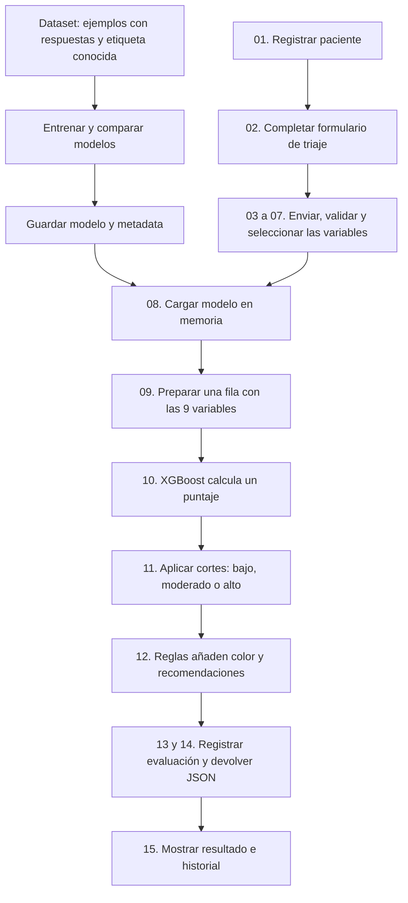

**Guía para exponer el recorrido del ML**

Los comentarios del código llevan el marcador `EXPO-ML`. Puedes buscarlo en todo el proyecto con Ctrl+Shift+F para recorrer los archivos. Los pasos E1–E6 explican el entrenamiento previo; los pasos 01–15 explican lo que ocurre cuando se utiliza la aplicación. Los sufijos `a` amplían un mismo paso.

Para una exposición con demostración, empieza en el paso 01. Cuando llegues al modelo, explica brevemente cómo se entrenó usando E1–E6 y vuelve al recorrido del paciente. No ejecutes el entrenamiento durante la demo: ese script sobrescribe el modelo y su metadata.

**Orden para seguir al paciente en el código**

| Paso | Archivo / punto de entrada | Qué puedes explicar |
|---|---|---|
| 01 | [PacientesPage.jsx](../frontend/src/pages/PacientesPage.jsx), `handleSubmit` | “Primero registramos al paciente. Esta operación guarda sus datos administrativos; la evaluación de ML se solicita después.” |
| 02 | [ModalTriaje.jsx](../frontend/src/components/triaje/ModalTriaje.jsx), `ModalTriaje` | “El profesional captura las respuestas. El formulario identifica cuáles utiliza el modelo y cuáles son complementarias.” |
| 03 | [triaje.js](../frontend/src/utils/triaje.js), `construirPayloadEvaluacion` | “Transformamos el formulario en nueve variables predictoras y un ID que vincula la evaluación al paciente.” |
| 04 | [evaluaciones.js](../frontend/src/services/evaluaciones.js), `crear` | “Enviamos el JSON a la API. El cliente añade el token de autenticación y espera la respuesta de Python.” |
| 05 / 05a | [evaluaciones.py](../app/api/v1/evaluaciones.py), `create_evaluacion`; [schema](../app/schemas/evaluacion.py), `EvaluacionCreate` | “FastAPI comprueba el contrato de entrada y autentica al usuario antes de delegar la evaluación.” |
| 06 | [evaluacion_service.py](../app/services/evaluacion_service.py), `evaluate` | “El servicio verifica que el paciente exista y coordina preparación, predicción y registro.” |
| 07 | [evaluacion_mapper.py](../app/mappers/evaluacion_mapper.py), `request_to_model_input` | “Seleccionamos solo los predictores y convertimos respuestas sí/no en uno/cero. Nombres y documentos quedan fuera del modelo.” |
| 08 | [model_loader.py](../app/ml/model_loader.py), `load_model` | “Recuperamos el modelo entrenado del archivo joblib y lo reutilizamos en memoria por proceso.” |
| 09 | [preprocessor.py](../app/ml/preprocessor.py), `preprocess` | “Adaptamos los datos al formato de entrenamiento: 55 años se convierten en categoría CDC 8 y las columnas conservan su orden.” |
| 10 | [predictor.py](../app/ml/predictor.py), `predict_proba` | “Aquí se ejecutan los árboles de XGBoost y se obtiene un puntaje para la clase positiva del dataset.” |
| 11 | [predictor.py](../app/ml/predictor.py), `_classify` | “Aplicamos los cortes del producto para obtener bajo, moderado o alto. Son bandas del puntaje.” |
| 12 / 12a | [evaluacion_triaje_service.py](../app/services/evaluacion_triaje_service.py), `generar_triaje_clinico`; [mapper](../app/mappers/evaluacion_mapper.py), `create_to_model` | “Las reglas del prototipo añaden color, factores registrados y recomendaciones; estos textos están escritos en el código.” |
| 13 | [evaluacion_repository.py](../app/repositories/evaluacion_repository.py), `create` | “Registramos entradas, resultado, versión, usuario y textos de la evaluación para mantener trazabilidad.” |
| 14 | [evaluacion_mapper.py](../app/mappers/evaluacion_mapper.py), `to_response` | “Armamos el objeto de salida y FastAPI lo devuelve como JSON con estado 201.” |
| 15 / 15a | [TriajePage.jsx](../frontend/src/pages/TriajePage.jsx), `guardarTriaje`; [TarjetaTriaje.jsx](../frontend/src/components/triaje/TarjetaTriaje.jsx) | “La interfaz muestra el índice, la banda y las recomendaciones, actualiza el historial y permite descargar el PDF.” |

**Cómo explicar el entrenamiento previo**

Abrir [entrenar_modelo.py](../entrenar_modelo.py), función `main`. Aquí están los comentarios E1–E6:

1. **E1 — Dataset y objetivo.** Se cargan datos BRFSS 2015 transformados en Kaggle. Las nueve variables forman `X`; el antecedente declarado de enfermedad coronaria o infarto forma `y`. Es aprendizaje supervisado porque se conocen las etiquetas de los ejemplos.
2. **E2 — Separación.** Se reserva 80% para entrenamiento y 20% para test, con proporciones de positivos similares y una semilla fija.
3. **E3 — Comparación.** Se prueban Random Forest y XGBoost con validación cruzada sobre train. La selección utiliza ROC AUC de validación cruzada.
4. **E4 — Aprendizaje.** `model.fit(X_train, y_train)` ajusta el estimador ganador. En la entrega actual el artefacto es XGBoost.
5. **E5 — Evaluación.** Se calculan métricas y se explora un umbral F1. El script actual elige ese umbral en el test; queda pendiente separarlo en validación independiente. Ese corte no es el utilizado para los tres colores.
6. **E6 — Exportación.** `joblib.dump` guarda el modelo y un JSON conserva versión, configuración, métricas y cortes. Luego la API puede cargarlo para predecir.

El entrenamiento ocurre antes de atender al paciente. Durante una evaluación se ejecuta `predict_proba`, no `fit`. Guardar una nueva evaluación o una atención médica no reentrena automáticamente el modelo.

**Explicación detallada y sencilla del flujo**

Hay dos momentos distintos en el proyecto. Primero se prepara el modelo con ejemplos históricos; después se utiliza ese modelo para evaluar las respuestas de un paciente. Esta separación permite que el trabajo de aprendizaje se haga previamente y que la aplicación solo tenga que ejecutar una predicción durante la consulta.



**Antes del paso 01: de dónde sale el conocimiento del modelo**

El entrenamiento activo utiliza un dataset con 253 680 registros. Cada ejemplo contiene características de una persona y una etiqueta que indica si declaró antecedentes de enfermedad coronaria o infarto. Para entrenar se seleccionan nueve características.

Piensa en una tabla donde las columnas de entrada son edad, presión alta y los demás factores; una última columna contiene la respuesta conocida. `X` representa las características y `y` representa esa respuesta. Durante `fit`, el algoritmo aprende asociaciones que ayudan a distinguir las dos etiquetas.

El script compara Random Forest y XGBoost. Para esta entrega se seleccionó XGBoost, que construye árboles de decisión de forma sucesiva: cada nuevo árbol busca mejorar los errores del conjunto anterior. Un árbol realiza decisiones sobre variables; varios árboles combinan sus aportes para formar el resultado. Las decisiones concretas las aprende el entrenamiento; no deben confundirse con los textos de recomendaciones escritos por el equipo.

Después se guarda el estimador en `modelo_cardiaco.joblib`. Ese archivo contiene la estructura y parámetros aprendidos necesarios para predecir. La ficha `modelo_cardiaco_metadata.json` documenta versión, variables, cortes y métricas. Durante la evaluación de un paciente la API carga el estimador; no necesita volver a leer el CSV ni buscar una persona idéntica en el dataset.

**01. Registrar al paciente: crear su identidad dentro del sistema**

El profesional registra nombres, documento, fecha de nacimiento y otros datos administrativos. El backend guarda el registro y asigna un identificador. Ese ID permitirá vincular todas las evaluaciones a la misma persona.

En este momento todavía no se calcula un puntaje. Registrar al paciente y evaluar sus factores son operaciones separadas. La fecha de nacimiento se utiliza después en el frontend para calcular la edad que se envía en la evaluación. Nombre y DNI sirven para identificar al paciente, pero no alimentan XGBoost.

**02. Completar el formulario: recoger las respuestas de esta evaluación**

El profesional selecciona al paciente y abre el modal de triaje. Allí registra antecedentes, hábitos y percepción de salud. Algunas respuestas pueden venir precargadas y deben verificarse para la nueva consulta.

Las secciones del formulario señalan qué datos utiliza el modelo. Por ejemplo, temperatura y saturación aparecen como apoyo visual, pero el payload de evaluación actual no las incluye. Tener un campo en pantalla no significa que XGBoost lo utilice.

**03. Construir el payload: preparar lo que viajará al backend**

`construirPayloadEvaluacion` toma el formulario y construye un objeto con los datos esperados por la API. A ese objeto se le suele llamar payload: es el contenido de la solicitud.

Para el perfil de ejemplo, el contenido es:

```json
{
  "paciente_id": 1,
  "edad": 55,
  "presion_alta": true,
  "colesterol_alto": true,
  "tabaquismo": false,
  "actividad_fisica": true,
  "antecedente_acv": false,
  "diabetes": true,
  "salud_general": 3,
  "dificultad_para_caminar": false
}
```

El ID 1 es ilustrativo; en la demo se utiliza el ID que tenga el paciente registrado. Hay diez campos en este objeto: nueve predictores y un identificador. El identificador no es una décima característica del modelo.

Actualmente la presión alta se activa por diagnóstico previo o lectura elevada; prediabetes y diabetes se agrupan en `true`. Esas transformaciones se hacen antes de llegar a Python. La edad todavía se expresa en años.

**04. Enviar la solicitud: comunicar React con Python**

El servicio del frontend hace un POST a `/api/v1/evaluaciones/`. POST significa que se solicita crear una nueva evaluación. El cliente añade el JWT, que permite al backend reconocer al usuario autenticado.

Mientras espera, la pantalla muestra “Evaluando...”. La aplicación web no calcula el resultado en el navegador: espera el trabajo del backend.

**05. Validar la entrada: comprobar formato y autenticación**

FastAPI utiliza `EvaluacionCreate` como contrato. Pydantic verifica los tipos y rangos declarados, como que edad sea un entero dentro del rango configurado y salud general esté entre 1 y 5. La dependencia de autenticación comprueba el token y que el usuario esté activo.

Esto verifica que la solicitud tenga un formato aceptable; no comprueba que las respuestas clínicas sean verdaderas. En la versión actual algunos campos omitidos reciben valores predeterminados, y el bloqueo de menores de 18 está en la interfaz: son mejoras pendientes del contrato de entrada.

**06. Coordinar la evaluación: el servicio organiza el trabajo**

`EvaluacionService.evaluate` verifica que exista el paciente y llama a cada capa en el orden necesario. Puedes entenderlo como el coordinador: pide preparar las variables, solicita la predicción y luego organiza el registro de la evaluación.

Aquí se mantiene el vínculo con la persona y con el usuario que hizo la operación. El servicio no implementa los árboles de XGBoost ni decide sus parámetros.

**07. Mapear los datos: seleccionar y traducir las variables**

El mapper recibe el objeto validado y crea un diccionario para ML. Convierte `true` en `1` y `false` en `0`. Mantiene edad y salud general como números y excluye `paciente_id`.

La idea de un mapper es traducir entre representaciones: la API necesita información administrativa, mientras que el modelo solo necesita sus nueve entradas. No se está aprendiendo nada en esta conversión.

**08. Cargar el modelo: recuperar lo que ya se aprendió**

`load_model` busca el archivo configurado y lo deserializa con joblib. Deserializar significa reconstruir en memoria el estimador que se guardó después del entrenamiento.

Tras la primera carga, el proceso reutiliza el objeto en memoria. Por eso las siguientes predicciones no necesitan volver a leer el archivo. Si se cambia el archivo en disco, el proceso que ya lo tenía cargado necesita una recarga explícita o reinicio para utilizar el nuevo modelo.

**09. Preprocesar: hablar el mismo idioma que el entrenamiento**

El modelo se entrenó con categorías de edad CDC. Por eso 55 años no se envía directamente como 55 a los árboles: se transforma en categoría 8, que corresponde a 55–59 años.

También se construye una tabla de pandas, llamada DataFrame, con una fila y nueve columnas. Una fila representa una evaluación. El orden es:

```text
edad, presion_alta, colesterol_alto, tabaquismo, actividad_fisica,
antecedente_acv, diabetes, salud_general, dificultad_para_caminar
```

Para el ejemplo, esa fila contiene `[8, 1, 1, 0, 1, 0, 1, 3, 0]`. La primera posición representa categoría de edad, la segunda presión alta, y así sucesivamente. Mantener significado, codificación y orden hace que el modelo reciba el mismo tipo de información con el que aprendió.

**10. Ejecutar la inferencia: obtener el puntaje del paciente**

Inferencia es utilizar un modelo ya entrenado con una entrada nueva. La línea central es:

```python
probabilidad = float(model.predict_proba(df)[0][1])
```

`predict_proba(df)` devuelve dos valores por fila, uno por cada clase. `[0]` selecciona la primera y única fila; `[1]` selecciona el valor de la clase positiva. El resultado del perfil de ejemplo con el artefacto v2.0.0 es `0.513150`.

El valor se conserva en el campo llamado `probabilidad`, pero para explicar el modelo activo debe tratarse como índice: la salida ponderada no está calibrada como probabilidad clínica. No indica directamente que esa persona tenga 51.3% de probabilidad de enfermedad.

El modelo utiliza las nueve variables de esa evaluación. No recibe el historial completo ni analiza automáticamente su evolución entre consultas. Dos solicitudes con el mismo vector, el mismo modelo y los mismos cortes producen el mismo resultado, aunque pertenezcan a personas distintas.

**11. Clasificar: convertir el número en una banda legible**

El predictor obtiene los cortes guardados en la metadata y aplica esta regla:

| Puntaje | Banda |
|---|---|
| Menor de 0.30 | Bajo |
| Desde 0.30 hasta menos de 0.60 | Moderado |
| Desde 0.60 | Alto |

Como `0.513150` está entre `0.30` y `0.60`, se devuelve `moderado`. El modelo aprendió dos etiquetas; los tres niveles son una transformación posterior del puntaje definida por el producto.

**12. Generar el triaje: añadir los textos del prototipo**

El servicio de reglas recibe la clasificación y las respuestas. Para `moderado` selecciona amarillo y los textos de seguimiento correspondientes. También enumera los antecedentes presentes y las respuestas consideradas protectoras.

Esta etapa permite convertir el resultado en información que se puede mostrar, pero las recomendaciones no se aprendieron durante `fit`. Tampoco la lista de factores mide cuánto influyó cada variable en XGBoost. En la exposición conviene diferenciar el cálculo del índice y las reglas que lo acompañan.

**13. Registrar la evaluación: conservar lo que se utilizó y obtuvo**

El mapper reúne los datos originales, el resultado y los textos del triaje. El repositorio crea una fila de evaluación vinculada al paciente y al usuario que la registró.

Se conservan las nueve respuestas utilizadas, puntaje, clasificación, versión del modelo, fecha y textos del triaje. Se guarda la edad en años para el historial; la conversión a categoría se utilizó al predecir. La sesión de base de datos gestiona la transacción y puede revertir cambios si ocurre un error.

Cada nueva evaluación crea un registro propio. Así se puede consultar qué se ingresó y qué devolvió el sistema en distintas visitas. Ese historial no actualiza por sí mismo los árboles del modelo.

**14. Devolver la respuesta: preparar el resultado para el navegador**

`to_response` transforma el registro en `EvaluacionResponse`, que FastAPI serializa a JSON. Serializar significa expresar los datos en un formato que el navegador pueda recibir. Si la creación termina correctamente, el endpoint responde con estado HTTP 201.

Un fragmento ilustrativo de la respuesta del ejemplo es:

```json
{
  "probabilidad": 0.51315,
  "clasificacion": "moderado",
  "modelo_version": "2.0.0",
  "triaje_clinico": {
    "codigo_color": "amarillo",
    "accion_sugerida": "Programar consulta médica de control en los próximos 15 a 30 días."
  }
}
```

La respuesta completa también incluye identificadores, variables evaluadas, fecha y las demás propiedades del triaje. Si el paciente no existe o falla el modelo, se devuelve un error en lugar de una evaluación exitosa; la pantalla informa el problema.

**15. Mostrar el resultado: cerrar el recorrido del paciente**

`guardarTriaje` recibe la respuesta y la guarda en el estado de React para mostrarla. La tarjeta presenta el índice, clasificación, factores y recomendaciones; después se actualizan las listas y conteos. El resultado también queda disponible en el historial.

La descarga del FUA es una solicitud posterior que genera un PDF a partir de la evaluación guardada. No necesita volver a predecir. Si el profesional registra luego un diagnóstico y tratamiento en consultorio, se crea una atención; actualmente esa atención tampoco reentrena automáticamente el modelo.

El flujo termina con un resultado disponible para revisión del profesional. El primer avance demuestra la integración entre captura, inferencia, reglas y persistencia; la utilidad clínica de las decisiones necesita evaluación adicional.

**Ejemplo breve para acompañar la demo**

Perfil: 55 años, presión alta, colesterol alto y diabetes; actividad física, sin antecedente de ACV, sin tabaquismo, salud general 3 y sin dificultad para caminar.

```text
Edad: 55 años -> categoría CDC 8
Vector: [8, 1, 1, 0, 1, 0, 1, 3, 0]
Puntaje del modelo v2.0.0: 0.513150
Banda: moderado, porque 0.30 <= puntaje < 0.60
Color: amarillo, por las reglas del prototipo
```

Puedes decir: “El modelo genera el puntaje. Después aplicamos reglas para clasificarlo, acompañarlo de recomendaciones y guardar la evaluación. El profesional recibe el resultado como apoyo para su revisión.”

**Precisiones para responder preguntas**

- **¿Qué predice?** Una asociación con el antecedente cardiovascular declarado que sirve como etiqueta del dataset. No se entrenó para predecir un infarto futuro con un plazo definido.
- **¿0.513150 significa 51.3% de enfermedad?** En el modelo activo se presenta como índice; no está calibrado como probabilidad clínica.
- **¿Por qué se usa XGBoost?** Fue el ganador de la comparación por ROC AUC de CV. La diferencia frente a Random Forest fue pequeña, así que no se afirma una superioridad grande.
- **¿Qué significa ROC AUC 0.8403?** Mide capacidad para ordenar casos positivos por encima de negativos. No significa 84.03% de aciertos.
- **¿Las recomendaciones las genera ML?** Las recomendaciones y colores vienen de reglas escritas por el equipo. Los factores enumeran respuestas registradas; no son atribuciones individuales de XGBoost.
- **¿Todos los datos del formulario entran al modelo?** Solo las nueve variables del payload. Los campos complementarios del modal no se guardan mediante el POST de evaluación; peso y talla del registro del paciente se almacenan aparte.
- **¿Aprende con cada paciente?** No. Para actualizarlo se necesita un entrenamiento separado, evaluación y una nueva versión del artefacto.
- **¿Qué está pendiente?** Mejorar validación de entradas, calibración, selección de umbrales y validación clínica en la población objetivo.

Frase de alcance para cerrar la presentación: “Presentamos un primer avance académico funcional que integra ML con registro, evaluación e historial. El resultado es experimental y su uso clínico requiere validación adicional.”
