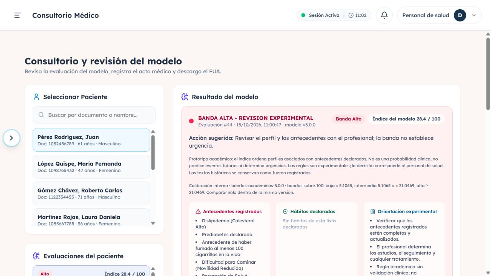
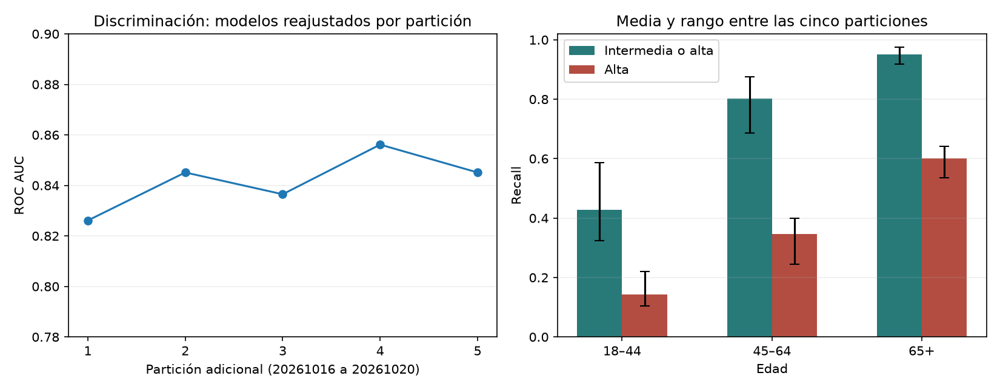

# Integración v3, estabilidad y generalización

Estado: 15/10/2026. Se integró el candidato calibrado como **3.0.0**, con reglas **bandas-academicas-3.0.0**. Se preservó la v2 y el historial. Se realizaron cinco particiones adicionales y se completó una evaluación temporal pública BRFSS 2017. Uso académico, sin validación clínica ni peruana.

## Integración del candidato

Se utiliza exactamente el candidato sigmoid del experimento original, sin elegir una semilla ganadora a partir de las repeticiones posteriores. Modelo y metadata están incluidos en `app/resources/`, con copias inmutables por versión en `app/resources/modelos/2.0.0/` y `3.0.0/`.

El score se redondea a seis decimales antes de clasificar, devolver y persistir. Se eligieron los cortes sobre el score redondeado de **validation 2015**, con criterios fijados antes de medir la cohorte externa:

| Score | Banda | Selección |
| --- | --- | --- |
| <0.051065 | bajo | El límite inferior es el mayor corte que conserva recall >=90% en validation |
| 0.051065 a <0.210469 | moderado | Entre ambos puntos de operación experimentales |
| >=0.210469 | alto | Máximo F1 en validation, empate mayor corte |

En pantalla se muestran sobre 100: **5.1065 y 21.0469**. El 90% es un objetivo de selección, no una garantía en test. Las bandas no determinan urgencia, diagnóstico, exámenes ni tratamiento. Calibración interna tampoco significa probabilidad clínica individual.

La metadata comprueba versión, columnas, cortes y política. El cargador verifica SHA256 y tipo de calibración antes de publicar la instancia en caché; una combinación incoherente produce error. `reload_model()` recarga también metadata y el predictor rechaza una caché incompatible. Las reglas nuevas identifican explícitamente bandas experimentales y recuerdan la variación de rendimiento por edad y sexo.

### Persistencia y compatibilidad

La migración **004** añade `politica_modelo JSON NULL`. Cada evaluación nueva guarda versión de reglas, cortes, semántica y precisión del score. La respuesta API, tarjeta web y PDF presentan esa política guardada. Un registro antiguo sin snapshot conserva sus textos; si requiere reconstrucción, usa la lógica histórica y no los cortes del calibrador actual.

Las migraciones 003 y 004 son repetibles, aditivas y se aplicaron a MySQL local sin recalcular el historial. No se comparan índices entre versiones como si compartieran escala. Los clientes anteriores pueden ignorar el nuevo campo de respuesta.

Se creó la evaluación de demostración **44** de Juan Pérez por HTTP: score **0.283712**, banda alta, modelo 3.0.0 y snapshot de reglas 3.0.0. La evaluación histórica **43** se consultó antes y después y conserva exactamente su respuesta. El PDF de la nueva evaluación se descargó y se inspeccionaron sus dos páginas. Evidencia: [JSON de integración](evidencias/integracion_v3.json).



## Estabilidad con otras particiones

Se repitió el procedimiento con semillas **20261016 a 20261020**: perfiles disjuntos entre entrenamiento, calibración, validación y test; parámetros XGBoost fijos; calibración sigmoid separada; umbrales de cada repetición elegidos exclusivamente en su validation. También cambia la semilla del estimador. Ninguna repetición se usó para sustituir el candidato original.

Evidencia completa: [protocolo](experimentos/estabilidad_v3/protocolo.json), [resultados](experimentos/estabilidad_v3/resultados.json), [subgrupos e intervalos por perfil](experimentos/estabilidad_v3/subgrupos.csv).

| Semilla | ROC AUC | Brier | Corte inferior | Recall intermedia/alta | Corte superior | F1 alta | Recall alta |
| --- | ---: | ---: | ---: | ---: | ---: | ---: | ---: |
| 20261016 | 0.8261 | 0.0777 | 0.042584 | 0.9328 | 0.214074 | 0.3923 | 0.5060 |
| 20261017 | 0.8451 | 0.0663 | 0.055574 | 0.8420 | 0.242261 | 0.4208 | 0.5190 |
| 20261018 | 0.8365 | 0.0623 | 0.053255 | 0.8299 | 0.221725 | 0.3978 | 0.4745 |
| 20261019 | 0.8562 | 0.0633 | 0.037025 | 0.9188 | 0.224547 | 0.4016 | 0.5424 |
| 20261020 | 0.8451 | 0.0674 | 0.040349 | 0.9119 | 0.241542 | 0.3922 | 0.4734 |

La discriminación se mantiene en ese rango interno; los puntos de operación y el recall tienen variación apreciable. En dos de las cinco repeticiones el recall del corte inferior cae por debajo de 90% en test. Las cohortes se solapan entre repeticiones: no son cinco estudios independientes ni los rangos son intervalos de confianza.



## Investigación de las diferencias entre subgrupos

Se reportaron los dos cortes, los cinco grupos principales y las seis intersecciones sexo×edad. El umbral es global dentro de cada repetición; no se retoca para mejorar los resultados de un subgrupo en test. Para los cinco grupos principales se añadieron intervalos de recall por **bootstrap de perfiles, 200 réplicas**, además de los Wilson descriptivos del análisis anterior. Son condicionales al modelo/umbral de cada repetición y no equivalen a diseño de encuesta complejo.

Rangos observados de recall en las cinco particiones:

| Grupo | Intermedia o alta | Solo alta |
| --- | --- | --- |
| Mujer (código 0) | 85.82–93.15% | 53.30–59.81% |
| Hombre (código 1) | 80.74–93.37% | 42.26–49.90% |
| 18–44 años | 32.38–58.72% | 10.48–22.02% |
| 45–64 años | 68.65–87.52% | 24.48–39.90% |
| 65+ años | 91.78–97.55% | 53.55–64.17% |

El corte inferior recupera más positivos jóvenes que el superior, pero también produce más falsos positivos. Entre mayores de 65, la especificidad del corte inferior varía entre 15.23% y 40.68%. No se solucionan las diferencias simplemente bajando un corte.

Para investigar la composición por edad, se calculó recall por sexo aplicando los mismos pesos de edad entre positivos del test a ambos sexos. Es una estandarización descriptiva, no una corrección causal:

| Semilla | Recall alta mujer estandarizado | Recall alta hombre estandarizado |
| --- | ---: | ---: |
| 20261016 | 0.5871 | 0.4489 |
| 20261017 | 0.5766 | 0.4786 |
| 20261018 | 0.5354 | 0.4272 |
| 20261019 | 0.6028 | 0.4964 |
| 20261020 | 0.5313 | 0.4330 |

La diferencia persiste en las cinco repeticiones después de igualar esa composición de edad: la edad por sí sola no explica la asociación observada. Podrían intervenir composición de antecedentes, selección de casos, variables omitidas y medición; este análisis no establece cuáles son las causas. Sexo no está en el vector predictor, pero eso no demuestra ausencia de diferencias o sesgo. No se ha implementado una mitigación cuya eficacia esté validada.

## Cohorte externa pública: BRFSS 2017

Se seleccionó una edición posterior de la misma encuesta, con nueve variables compatibles y el mismo objetivo retrospectivo. Es una evaluación **temporal de EE.UU.**, no una cohorte peruana ni una confirmación clínica independiente. No garantiza ausencia de participantes repetidos entre años porque no hay identificadores longitudinales.

Fuente oficial: [CDC, edición 2017](https://www.cdc.gov/brfss/annual_data/annual_2017.html), [layout de columnas](https://www.cdc.gov/brfss/annual_data/2017/llcp_varlayout_17_onecolumn.html) y [variables calculadas](https://www.cdc.gov/brfss/annual_data/2017/pdf/2017-calculated-variables-version4-508.pdf). La descarga directa respondió HTTP 403; se utiliza la [copia pública archivada por University of Montana](https://topofire.dbs.umt.edu/public_data/federal_public_datasets/CDC%20Behavioral%20Risk%20Factor%20Surveillance%20System%20/2017%20Annual%20Survey%20Data/Data%20Files/).

Mapeo explícito, sin imputar desconocidos como negativos:

| Campo 2017 | Destino y transformación |
| --- | --- |
| `_AGEG5YR` | Edad CDC 1–13; excluir 14/desconocidos |
| `BPHIGH4` | Hipertensión: 1 positivo; 2/3/4 negativos |
| `TOLDHI2` | Colesterol: 1 positivo, 2 negativo |
| `SMOKE100` | Tabaco de por vida: 1 positivo, 2 negativo |
| `EXERANY2` | Actividad en 30 días: 1 positivo, 2 negativo |
| `CVDSTRK3` | ACV: 1 positivo, 2 negativo |
| `DIABETE3` | 1 diabetes y 4 prediabetes positivos; 2 solo embarazo y 3 ninguna negativos |
| `GENHLTH` | Salud 1–5 |
| `DIFFWALK` | Movilidad: 1 positivo, 2 negativo |
| `_MICHD` | Target: 1 CHD/infarto declarado; 2 negativo |
| `SEX` | Solo auditoría: 1 hombre→1, 2 mujer→0 |

Se exige completitud de estas variables; se publican los conteos de exclusión por variable, que pueden solaparse. La selección no reproduce todas las exclusiones de las 22 columnas del archivo transformado de 2015: existe posible cambio de composición por ese motivo. Los resultados son por fila sin pesos de encuesta, no estimaciones poblacionales nacionales. Las coincidencias de perfiles discretos entre años no se interpretan como identidad de personas ni se eliminan automáticamente.

La release y su política se congelaron antes de descargar/evaluar 2017. No se ajustan calibrador, umbrales o modelo con estos datos. La importación valida tamaño de registro, recuento esperado, rangos HTTP y codificaciones; conserva hashes de datos derivados y segmentos, además de la procedencia del prefijo reanudado tras una interrupción. No se afirma disponer de un hash oficial CDC de la copia completa.

### Resultados externos con modelo y cortes congelados

De **450,016 registros** se incluyeron **373,536** y se excluyeron **76,480** por respuestas ausentes/no admitidas en las variables requeridas. Hubo **34,408 positivos** (9.21%). Los conteos por variable se publican en [resultados externos](experimentos/externa_brfss2017_v3/resultados.json); pueden solaparse. [Protocolo y procedencia](experimentos/externa_brfss2017_v3/protocolo.json) y [subgrupos externos](experimentos/externa_brfss2017_v3/subgrupos.csv).

ROC AUC **0.8398**, AP **0.3509**, Brier **0.0704**, log loss **0.2396**, ECE descriptivo de 10 bins uniformes **0.0096**.

| Punto de operación | Precision | Recall | Especificidad | F1 | Fracción marcada |
| --- | ---: | ---: | ---: | ---: | ---: |
| >=0.051065, intermedia o alta | 0.1857 | 0.8971 | 0.6009 | 0.3077 | 0.4450 |
| >=0.210469, alta | 0.2991 | 0.5963 | 0.8582 | 0.3984 | 0.1836 |

Recall IC95% condicional por bootstrap de perfiles: **0.8849–0.9107** al corte inferior y **0.5677–0.6262** al superior. No son intervalos con el diseño complejo de encuesta ni incluyen reajuste de modelo. El 0.50 se reporta solo como referencia: recall 0.0076; no se adopta como umbral.

| Grupo externo | Casos | Positivos | Recall intermedia/alta | Recall alta |
| --- | ---: | ---: | ---: | ---: |
| Mujer | 211,098 | 15,389 | 90.79% | 63.26% |
| Hombre | 162,438 | 19,019 | 88.85% | 56.70% |
| 18–44 | 94,187 | 1,317 | 42.14% | 16.25% |
| 45–64 | 142,027 | 10,352 | 82.05% | 46.89% |
| 65+ | 137,322 | 22,739 | 95.96% | 67.94% |

La baja recuperación de positivos jóvenes persiste en la cohorte temporal. En mayores de 65, la especificidad al corte inferior es 22.66%, señal de muchos falsos positivos. La calibración no resuelve estos puntos de operación. No se afina ningún corte después de verlos.

**371,792 filas externas** comparten un patrón de nueve features con alguna fila de 2015. Es esperable con variables discretas, pero limita la interpretación como extrapolación a perfiles completamente nuevos. No demuestra que sean las mismas personas. La evaluación nueva aporta separación temporal de registros y preserva el objetivo; no independencia de fuente, identidad longitudinal confirmada o validez asistencial peruana.

El SHA256 del modelo evaluado es `d20e69f5ca053df7a1e459705f89dca5e8fb74d7af408c34281a559d490df27f`, igual al artefacto activo. Los resultados son evidencia temporal compatible con lo observado internamente, sin una comparación causal de mejora frente a v2 ni una afirmación de calibración clínica.

## Pruebas y operación

- **125 pruebas backend aprobadas** en 55.46 segundos; 54 advertencias de deprecación de dependencias (`python-jose` y `joblib`/NumPy). Evidencia: [validación v3](evidencias/validacion_v3.json). Suite de regresión backend y pruebas de release: contrato HTTP, predicción real, bordes de bandas, snapshot persistido, historial, migración repetible y PDF.
- Guardas negativas: metadata incompatible, hash incorrecto, política desconocida y calibrador publicado con versión histórica se rechazan.
- Frontend: **5 pruebas**, lint y build correctos. Verificación visual del consultorio con evaluación 44 y versión/cortes visibles; revisión del PDF descargado.
- La app se comprobó en `http://127.0.0.1:8001` y se reinició la instancia del puerto habitual **8000** para cargar el modelo y build nuevos. Cualquier otra instancia antigua debe reiniciarse también.

```bash
python scripts/aplicar_migracion_004.py
python -m pytest app/tests -q
# Evaluar el archivo externo ya descargado, en un directorio de informe nuevo:
python scripts/evaluar_brfss_2017.py
# Descarga/importación desde el archivo público si no hay cohorte local guardada:
python scripts/evaluar_brfss_2017.py --descargar
```

Los scripts de estabilidad e importación conservan resultados en carpetas nuevas; no deben sobrescribirse para esconder una ejecución anterior. Los datos por fila quedan en `experimentos_ml/` excluido de Git; informes agregados en `docs/experimentos/`.

## Qué sigue faltando

1. Una cohorte realmente local o de otra fuente clínica compatible, con etiqueta verificable, permisos y separación de personas. La evaluación temporal pública no reemplaza eso.
2. Diseñar y evaluar mitigaciones para el recall bajo en jóvenes y las diferencias por sexo, con objetivo de uso acordado y otra evaluación reservada. Las tablas ya observadas no deben convertirse en datos para ajustar cortes y luego anunciar rendimiento independiente sobre ellas.
3. Evaluación profesional de utilidad y reglas antes de cualquier uso asistencial; seguimiento, monitoreo y mantenimiento de la calibración. La integración técnica y una prueba externa no acreditan seguridad clínica.

Para la entrega académica, la contribución verificable es la integración versionada y un análisis reproducible que expone estabilidad y limitaciones, sin afirmar que se han eliminado.
