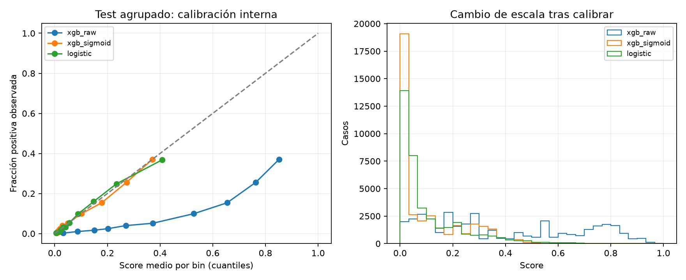

> Actualización posterior: el candidato se integró como v3.0.0. Este informe conserva el estado al cerrar su etapa; ver [estado vigente de integración](INTEGRACION_V3_Y_GENERALIZACION.md).

# Segunda etapa experimental — 15/10/2026

Se implementó y ejecutó un protocolo offline con separación de entrenamiento, calibración, selección de umbral y test; sensibilidad a duplicados; baselines; intervalos y auditoría por sexo y edad. Se conservan el modelo v2.0.0, sus bandas y los resultados históricos de la aplicación. Los candidatos nuevos no están activados en la API.

La evidencia agregada está en [protocolo](experimentos/segunda_etapa_20261015_final/protocolo.json), [resultados completos](experimentos/segunda_etapa_20261015_final/resultados.json) y [subgrupos CSV](experimentos/segunda_etapa_20261015_final/subgrupos.csv). Los modelos, copias del código y artefacto activo de referencia, particiones y predicciones por fila se guardaron localmente en `experimentos_ml/segunda_etapa_20261015_final/`, excluido de Git.

## Protocolo y separación de decisiones

1. Se fijaron semilla `20261015`, nueve features, escenarios, parámetros y criterios en un JSON antes de entrenar. La configuración XGBoost procede de la v2: 400 árboles, profundidad 3, learning rate 0.05, subsample/colsample 0.8. No se realizó una nueva búsqueda ni se eligió configuración por el test nuevo. La ponderación se calcula únicamente con train; no se justifica por poblar colores.
2. Se reservan aproximadamente 60% para entrenamiento, 15% para calibración, 10% para validación y 15% para test. En el escenario principal se asignan perfiles completos, por lo que las proporciones y prevalencias por fila varían. Cada fila participa en una sola partición.
3. El modelo base se ajusta solo en train. La calibración sigmoid se ajusta solo en calibration, con el estimador base congelado (`FrozenEstimator` y `CalibratedClassifierCV`). No se vuelve a entrenar usando calibration o validation después.
4. Para cada variante se maximiza F1 exclusivamente en validation; en empate se elige el mayor umbral. Entre XGBoost crudo y sigmoid se elige el menor Brier de validation, con preferencia por el crudo en empate. La regresión logística es un baseline independiente, no un ganador elegido por test.
5. Se escriben las decisiones a disco antes de obtener las predicciones del test. El test se usa para medir, sin mover umbrales ni ajustar calibradores. Se reporta también 0.50 como referencia, no como umbral elegido.

**Independencia dentro del experimento no significa datos externos nuevos:** el CSV completo ya se había explorado en el proyecto, y los hiperparámetros provienen del trabajo anterior. Este diseño corrige el ajuste directo del umbral sobre test, pero no borra esa historia ni constituye una validación prospectiva o clínica.

## Duplicados y escenarios

Hay **23,899 filas completas excedentes repetidas** y 35,086 filas que pertenecen a grupos completos repetidos. Con solo las nueve features hay **5,630 perfiles distintos**, de los cuales **3,263 tienen ambas etiquetas** entre sus filas. Esto muestra que las respuestas disponibles no determinan unívocamente la etiqueta; no identifica personas ni demuestra un error del dataset.

Se ejecutaron tres escenarios predefinidos:

- **Filas:** separación estratificada por etiqueta; mantiene perfiles iguales en particiones diferentes como referencia de sensibilidad.
- **Perfiles (principal):** agrupa por las nueve features ya transformadas, sin incluir target ni sexo. Un perfil nunca aparece en dos particiones, incluso si sus etiquetas difieren. Hay cero perfiles compartidos en las seis comparaciones entre particiones. Es una evaluación más exigente de perfiles no vistos; no equivale a una partición por personas, porque no hay identificadores.
- **Sin duplicados completos:** conserva una fila por combinación completa del CSV y vuelve a separar por los mismos grupos de nueve features. Es un análisis de sensibilidad, no una limpieza adoptada como verdad: respuestas idénticas pueden pertenecer a personas distintas.

Particiones del escenario principal:

| Uso | Filas | Positivos | Perfiles |
| --- | ---: | ---: | ---: |
| Train | 152,725 | 13,822 | 3,378 |
| Calibration | 36,116 | 3,778 | 844 |
| Validation | 27,564 | 2,495 | 563 |
| Test | 37,275 | 3,798 | 845 |

La prevalencia del test agrupado es 10.19%, frente a 9.05% en train y validation y 10.46% en calibration. No se forzó igualdad de prevalencias mirando etiquetas durante la asignación por grupos.

## Resultados del test principal

Todos los umbrales de esta tabla se eligieron en validation. La variante XGBoost sigmoid fue seleccionada por su Brier de validation: 0.0692, frente a 0.1745 del crudo.

| Modelo | Umbral | ROC AUC | AP | Precision | Recall | F1 | Brier |
| --- | ---: | ---: | ---: | ---: | ---: | ---: | ---: |
| XGBoost crudo | 0.697621 | 0.8285 | 0.3513 | 0.2953 | 0.6435 | 0.4048 | 0.1907 |
| XGBoost sigmoid | 0.210469 | 0.8285 | 0.3513 | 0.2953 | 0.6435 | 0.4048 | 0.0773 |
| Regresión logística | 0.167385 | 0.8259 | 0.3489 | 0.2907 | 0.6517 | 0.4020 | 0.0774 |
| Prevalencia de train, constante | 0.50 fijo | 0.5000 | 0.1019 | 0 | 0 | 0 | 0.0916 |

La regresión logística usa StandardScaler ajustado en train, C=1 y sin ponderación de clases; trata los códigos de edad y salud como variables numéricas. Es un baseline sencillo y reproducible, no una búsqueda exhaustiva de modelos lineales.

La calibración reduce el error cuadrático de los scores y el ECE descriptivo (10 bins uniformes) de **0.2875 a 0.0091**. Log loss pasa de 0.5537 a 0.2607. No mejora la ordenación: la transformación sigmoid conserva aquí ROC AUC, AP y, al transportar el umbral, las mismas decisiones binarias. No hay una mejora de F1 atribuible a calibrar.

Para el candidato seleccionado, los intervalos percentiles 95% de 200 réplicas bootstrap por perfil son:

| Métrica | Estimación | IC 95% |
| --- | ---: | --- |
| ROC AUC | 0.8285 | 0.8040–0.8487 |
| AP | 0.3513 | 0.3219–0.3750 |
| F1 | 0.4048 | 0.3804–0.4277 |
| Recall | 0.6435 | 0.5675–0.7122 |
| Brier | 0.0773 | 0.0658–0.0892 |

Estos intervalos condicionan en el modelo y el umbral ya elegidos: no incluyen incertidumbre de reentrenamiento o de selección del split. Dos ejecuciones completas produjeron exactamente las mismas métricas; eso verifica reproducibilidad con la semilla y el entorno registrados, no estabilidad entre semillas. La pequeña ventaja puntual frente a logística no demuestra superioridad estadística o clínica.



## Sensibilidad a la separación y deduplicación

Resultados del XGBoost calibrado, con su propio umbral seleccionado en validation de cada escenario:

| Escenario | Test | Prevalencia test | ROC AUC | AP | F1 | Brier |
| --- | ---: | ---: | ---: | ---: | ---: | ---: |
| Filas | 38,052 | 9.42% | 0.8423 | 0.3581 | 0.4087 | 0.0712 |
| Perfiles | 37,275 | 10.19% | 0.8285 | 0.3513 | 0.4048 | 0.0773 |
| Sin duplicados completos + perfiles | 34,590 | 10.92% | 0.8199 | 0.3547 | 0.4088 | 0.0826 |

El escenario por filas comparte 3,368 perfiles entre train y test. La reducción de AUC al separar perfiles hace relevante reportar esa sensibilidad. Las muestras de test, sus prevalencias y ponderaciones cambian entre escenarios; las diferencias no son una estimación causal aislada de «cuánto inflan los duplicados». AP depende de prevalencia y tampoco debe compararse sin ese contexto.

## Auditoría por subgrupos

Sexo se usa solo offline para auditoría. Las edades se recuperan de las categorías CDC. Se aplica a todos el mismo umbral global 0.210469; no se ajustaron umbrales por grupo usando el test.

| Grupo | Casos | Positivos | Recall | Especificidad |
| --- | ---: | ---: | ---: | ---: |
| Sexo 0, mujer | 21,139 | 1,673 | 69.34% | 81.44% |
| Sexo 1, hombre | 16,136 | 2,125 | 60.42% | 84.16% |
| 18–44 años | 6,798 | 91 | 26.37% | 99.39% |
| 45–64 años | 15,298 | 1,122 | 45.99% | 90.61% |
| 65+ años | 15,179 | 2,585 | 73.66% | 64.58% |

El recall en 18–44 es bajo con este objetivo F1 y umbral global; en mayores de 65 hay más falsos positivos. Existe una diferencia descriptiva por sexo de 8.91 puntos de recall. No se concluye equidad ni discriminación causal a partir de estas diferencias: prevalencia, composición y variables disponibles también cambian.

El CSV/JSON incluye las seis intersecciones sexo×edad y las mismas tablas para XGBoost crudo y logística, además de AUC/AP, Brier, tasas de alertas, matrices y conteos. Los intervalos Wilson de recall/FPR por subgrupo son descriptivos bajo independencia por fila; pueden ser demasiado estrechos con perfiles repetidos. No son pruebas ajustadas por múltiples comparaciones. Los intervalos globales sí remuestrean perfiles completos. Sin positivos, recall y sus intervalos se reportan como no definidos.

## Por qué el candidato no reemplaza automáticamente el modelo de la app

La calibración cambia la escala: si se copiaran los cortes 0.30/0.60 al nuevo score, **ninguno de los 37,275 casos del test principal quedaría en banda alta**, frente a 10,721 con el candidato crudo. Esto no es un motivo para distorsionar probabilidades y poblar colores; muestra que los cortes anteriores no son transportables.

El umbral binario F1=0.210469 tampoco define tres bandas ni un criterio asistencial. Se conserva el contrato activo de la demo para evitar cambiar silenciosamente el significado de la interfaz y de las evaluaciones históricas. El candidato calibrado puede cargarse offline con `joblib.load` y las mismas nueve columnas; se verificó su serialización y predicción tras cargarlo.

## Repetir y conservar evidencia

```bash
# Requiere el CSV local y las dependencias de desarrollo, incluida matplotlib.
# Ambos destinos deben ser nuevos. El primero debe estar dentro de experimentos_ml/.
python entrenar_modelo.py --output experimentos_ml/mi_ejecucion --report-dir docs/experimentos/mi_ejecucion --bootstrap 200
python -m pytest app/tests -q
```

Sin argumentos se genera una carpeta local nueva con fecha UTC. El script rechaza sobrescribir carpetas existentes o usar `app/resources` como destino. No promueve modelos. La evidencia incluye hashes SHA256 del CSV, código, referencia activa y nuevos artefactos; versiones de librerías; copias de código y modelo activo; asignaciones y decisiones previas al test. El dataset no se distribuye dentro del informe: debe obtenerse de la fuente y comprobar su hash.

`scripts/generar_figuras.py` sigue reproduciendo el artefacto activo v2 con su split histórico 80/20 seed 42. Sus figuras y métricas no pertenecen a este experimento nuevo. La segunda etapa dispone de su propia figura y JSON separados.

## Verificación de implementación

- Suite completa: **111 pruebas aprobadas** en 25.39 segundos; 45 advertencias existentes de deprecación de `python-jose`. La creación de sockets internos de TestClient se bloqueaba dentro del aislamiento de Windows; la ejecución local fuera de ese aislamiento completó la suite.
- Doce pruebas nuevas comprueban particiones exhaustivas y sin perfiles compartidos, asignación independiente de etiquetas, umbral fijo ante resultados de test distintos, calibración que no reentrena el estimador, subgrupos con una clase, bootstrap reproducible, codificaciones del dataset y rechazo del directorio del modelo activo como destino.
- Una prueba cambia exclusivamente las etiquetas del test y confirma que no cambian los modelos entrenados, calibradores, umbrales ni la variante seleccionada.
- Dos ejecuciones completas del experimento obtuvieron métricas idénticas. Los hashes de código, runtime y todos los artefactos del informe coinciden con sus archivos.
- El modelo y la metadata activos conservan sus hashes y reproducen exactamente todas sus métricas históricas a 0.50. Se verificó la carga y predicción de cada candidato serializado y se inspeccionó la figura generada.
- Los enlaces locales de la documentación vigente y `git diff --check` son correctos. No hubo cambios de interfaz ni de esquema de base de datos en esta etapa.

## Qué falta después de esta etapa

1. **Integración de un candidato:** acordar el objetivo académico de las bandas, fijar sus reglas usando desarrollo/validación y versionar conjuntamente modelo, calibración y reglas; luego probar API, interfaz e historial con esa nueva semántica. Evitar elegir cortes para mejorar el test ya observado. La aplicación aún usa v2 sin calibrar.
2. **Generalización:** repetir con varias semillas o validación anidada y obtener una cohorte externa/local realmente nueva, preferiblemente con identificadores que permitan separar personas y con una definición clínica verificable del objetivo. Reutilizar este CSV no reemplaza esa evidencia. No se aplican pesos de encuesta porque el archivo transformado utilizado no contiene el diseño completo; no se estiman prevalencias poblacionales clínicas.
3. **Subgrupos:** investigar el recall reducido en jóvenes, ampliar intervalos por grupos/perfiles y acordar el balance entre falsos negativos y falsos positivos. Cualquier mitigación debe diseñarse con datos de desarrollo y comprobarse con una nueva evaluación reservada, no optimizarse sobre las tablas publicadas.
4. **Si se busca uso asistencial:** validación profesional de reglas y utilidad, consentimiento y protección/retención de datos, monitoreo y mantenimiento. La calibración interna no autoriza decisiones clínicas ni pronósticos futuros.

Para una entrega académica, ya se puede defender el protocolo y sus resultados con estas limitaciones. No hace falta afirmar que el modelo predice eventos futuros, que todos los grupos rinden igual o que se ha demostrado utilidad clínica.

## Referencias metodológicas

- [scikit-learn: selección de umbrales con datos separados](https://scikit-learn.org/stable/modules/classification_threshold.html).
- [scikit-learn: calibración de estimadores ya entrenados y separación de datos](https://scikit-learn.org/stable/modules/generated/sklearn.calibration.CalibratedClassifierCV.html).
- [scikit-learn: validación y dependencia por grupos](https://scikit-learn.org/stable/modules/cross_validation.html).
- [Fuente del CSV transformado](https://www.kaggle.com/datasets/alexteboul/heart-disease-health-indicators-dataset).
