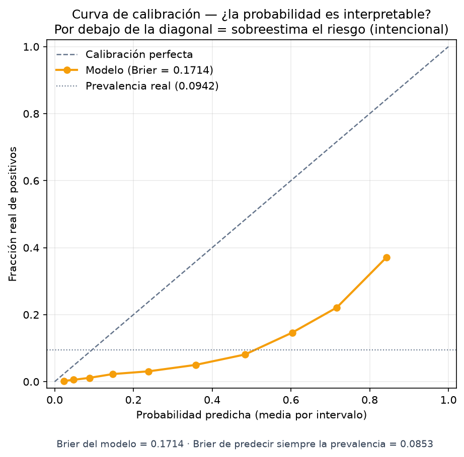

> Histórico: documentación de v2 antes de integrar la release calibrada. Ver [versión vigente](../MODELO_ML.md).

# Componente ML de CardioPredict

Referencia técnica vigente, alineada el 15/10/2026. Uso académico. Ver [MODEL_CARD](../MODEL_CARD.md) para población, usos y limitaciones y [TRIAGE_CLINICO](../TRIAGE_CLINICO.md) para las reglas del producto.

## Objetivo y alcance

El modelo clasifica perfiles asociados con **antecedentes autodeclarados de enfermedad coronaria o infarto** en adultos. Su etiqueta es `HeartDiseaseorAttack` de la versión transformada de BRFSS 2015. No hay seguimiento temporal: no predice un infarto futuro ni el desarrollo de cualquier enfermedad cardíaca.

La salida es un **score no calibrado de 0 a 1**. Se conserva el nombre histórico `probabilidad` en la API y la base de datos para mantener la compatibilidad. La interfaz y el PDF lo muestran como **índice del modelo de 0 a 100**, sin símbolo de porcentaje. No es una probabilidad clínica.

Las bandas y orientaciones son reglas experimentales del prototipo, sin validación clínica; no deciden diagnóstico, urgencia, tratamiento ni derivación.

## Flujo y archivos

```text
Formulario → POST /api/v1/evaluaciones/ → validación del paciente y edad
 → mapper (nueve variables) → preprocess (años a código CDC)
 → modelo .joblib → score → bandas experimentales
 → reglas deterministas → persistencia → historial y PDF
```

| Archivo | Función |
|---|---|
| `entrenar_modelo.py` | Entrada al experimento offline de segunda etapa; conserva helpers para reproducir figuras históricas |
| `app/ml/experiment.py` | Cuatro particiones, calibración, umbrales en validation, duplicados, baselines, intervalos y subgrupos |
| `app/ml/dataset.py` | Contrato y codificación compartidos del CSV |
| `app/ml/preprocessor.py` | Valida presencia y rangos; convierte años a código CDC y ordena columnas |
| `app/ml/model_loader.py` | Carga única del artefacto en memoria |
| `app/ml/metadata.py` | Lee versión y umbrales del JSON; incluye fallbacks históricos |
| `app/ml/predictor.py` | Ejecuta `predict_proba` y obtiene la banda |
| `app/services/evaluacion_service.py` | Verifica existencia, mayoría de edad y coherencia con fecha de nacimiento |
| `app/mappers/evaluacion_mapper.py` | Traduce request, input ML, persistencia y respuesta |
| `app/services/evaluacion_triaje_service.py` | Textos experimentales y antecedentes presentes, sin atribuciones del modelo |

## Entradas obligatorias

La API exige `paciente_id` y los **nueve predictores**; ningún predictor omitido se completa por defecto. Null tampoco representa una respuesta desconocida admitida por este modelo.

| Variable | Contrato y significado |
|---|---|
| `edad` | Entero 18–120; debe coincidir con fecha de nacimiento a la fecha de la consulta, America/Lima |
| `presion_alta` | Booleano: diagnóstico previo de hipertensión declarado. No se deriva de una lectura aislada |
| `colesterol_alto` | Booleano: antecedente de colesterol alto declarado |
| `tabaquismo` | Booleano: haber fumado al menos 100 cigarrillos durante la vida; no indica consumo actual |
| `actividad_fisica` | Booleano: actividad física declarada durante los últimos 30 días |
| `antecedente_acv` | Booleano: antecedente declarado de ACV |
| `diabetes` | Booleano agrupado: prediabetes o diabetes declarada |
| `salud_general` | Entero 1–5: excelente, muy buena, buena, regular, mala |
| `dificultad_para_caminar` | Booleano: dificultad para caminar o subir escaleras |

El orden anterior coincide con las nueve features del artefacto. Los campos adicionales no entran al modelo:

- `estado_diabetes`: opcional para clientes antiguos; `ninguna`, `prediabetes` o `diabetes`. Si se envía debe ser coherente con el booleano. El formulario actual siempre lo envía.
- `presion_sistolica`, `presion_diastolica`: opcionales, en mmHg, ambas o ninguna. Enteros positivos hasta 400 y sistólica mayor que diastólica. Es una validación de formato, no un diagnóstico. Se conservan por separado.

Una evaluación histórica con `diabetes=true` y sin categoría se muestra como «Prediabetes o diabetes (sin detalle registrado)». Al reabrir el formulario requiere confirmar la categoría; nunca se precarga como diabetes confirmada.

### Codificación de edad

| Código | Años | Código | Años |
|---|---|---|---|
| 1 | 18–24 | 8 | 55–59 |
| 2 | 25–29 | 9 | 60–64 |
| 3 | 30–34 | 10 | 65–69 |
| 4 | 35–39 | 11 | 70–74 |
| 5 | 40–44 | 12 | 75–79 |
| 6 | 45–49 | 13 | 80+ |
| 7 | 50–54 | | |

El CSV ya contiene códigos; el entrenamiento no vuelve a convertirlos. La API recibe años y `preprocess` convierte una sola vez.

### Errores

- 422: predictor faltante, menor de 18 en el body, rango inválido, categoría de diabetes contradictoria o medición incompleta.
- 400: paciente inexistente, paciente menor según nacimiento o edad enviada distinta de la registrada.
- 401: falta autenticación válida.
- 500: modelo no disponible o fallo del pipeline.

## Modelo y datos incluidos

| Campo | Valor |
|---|---|
| Artefacto | `app/resources/modelo_cardiaco.joblib` |
| Metadata | `app/resources/modelo_cardiaco_metadata.json` |
| Versión / algoritmo | 2.0.0 / XGBoost |
| Configuración | 400 árboles, profundidad 3, learning_rate 0.05, subsample y colsample_bytree 0.8 |
| Ponderación | scale_pos_weight 9.62 |
| Fuente | Heart Disease Health Indicators, BRFSS 2015, EE.UU. |
| CSV | 253,680 filas; 22 columnas totales, incluyendo target; se usan nueve predictores |
| Positivos | 23,893 (9.42%) |
| Split actual | 80/20 estratificado, seed 42: 202,944 / 50,736 |

El CSV se descarga aparte y está excluido de Git. Diabetes del CSV se agrupa con `>0`; la agrupación se mantiene en inferencia. No confundir los códigos transformados de Kaggle con los del cuestionario original.

El entrenamiento histórico del artefacto v2 realizó RandomizedSearchCV, tres folds, ocho candidatos por familia, scoring ROC AUC y average precision. Selecciona por ROC AUC: XGBoost 0.8391 frente a RF 0.8373. Es una diferencia pequeña; no prueba superioridad general ni equivalencia estadística. La semilla y las versiones de librerías se guardan/documentan para repetir el experimento.

## Métricas verificadas del artefacto

| Corte | Precision | Recall | F1 | FN | FP |
|---|---|---|---|---|---|
| 0.30: moderado o alto | 0.1770 | 0.9188 | 0.2968 | 388 | 20,416 |
| 0.50: referencia binaria | 0.2297 | 0.8192 | 0.3588 | 864 | 13,126 |
| 0.60: alto | 0.2716 | 0.7154 | 0.3938 | 1,360 | 9,168 |
| 0.7026: óptimo exploratorio | 0.3242 | 0.5581 | 0.4101 | 2,112 | 5,560 |

ROC AUC **0.8403**; average precision **0.3537** (el proyecto la llama PR AUC, calculada con `average_precision_score`). El recall 81.92% pertenece a 0.50, no al semáforo entero. Matriz a 0.50: `[[32831,13126],[864,3915]]`.

### Bandas experimentales vigentes

| Score | Índice mostrado | Banda | Casos test | Positivos observados |
|---|---|---|---|---|
| <0.30 | <30 | bajo | 25,929 | 388 (1.50%) |
| 0.30 a <0.60 | 30 a <60 | moderado | 12,220 | 972 (7.95%) |
| >=0.60 | >=60 | alto | 12,587 | 3,419 (27.16%) |

Los cortes se leen de metadata. Poblar tres bandas no demuestra utilidad clínica. Los textos son reglas del equipo, no salidas aprendidas ni explicaciones SHAP. El 8.1% de los positivos del test queda **dentro** de la banda baja.

### Calibración y evidencia gráfica

Brier del modelo **0.1714**, frente a **0.0853** de predecir siempre la prevalencia. La ponderación contribuye a distorsionar la interpretación probabilística; se evalúa el score como ordenación interna. No hay evidencia de probabilidades clínicas calibradas.

Con predicción en X y frecuencia observada en Y, **por debajo de la diagonal significa sobreestimación**.



Las otras figuras en [figuras](../figuras/) muestran ROC, precision-recall, matriz de confusión, importancia global por gain, barrido de umbral y distribución. La importancia global no explica por qué un paciente individual recibió su score.

## Segunda etapa implementada y límites restantes

Se ejecutó un experimento separado con train/calibration/validation/test (aproximadamente 60/15/10/15), umbrales elegidos en validation, calibración sigmoid fuera de train y test, sensibilidad a perfiles repetidos/deduplicación, logística y prevalencia como baselines, intervalos por bootstrap de perfiles y subgrupos sexo×edad. Código, hashes, decisiones y artefactos quedan versionados por ejecución.

En el test principal sin perfiles compartidos: ROC AUC 0.8285, AP 0.3513, F1 0.4048 y recall 0.6435 al umbral de validation 0.210469 del candidato calibrado. Brier pasó de 0.1907 (candidato crudo) a 0.0773 (sigmoid), frente a 0.0916 del baseline constante. No comparar estas cifras como una mejora directa sobre v2: cambian entrenamiento y muestra de test. El recall varía por edad y sexo.

El artefacto activo v2 y las métricas históricas anteriores permanecen intactos. Los candidatos nuevos **no están activados en la aplicación**: las bandas 0.30/0.60 no son transportables al score calibrado. La evaluación nueva corrige la selección de umbral dentro del experimento; el CSV y los hiperparámetros ya habían sido estudiados, por lo que no equivale a una cohorte externa nunca observada.

El [informe de segunda etapa](../SEGUNDA_ETAPA_EXPERIMENTAL.md) contiene el protocolo, resultados completos y pendientes: integración/versionado de nuevas bandas, estabilidad entre particiones, validación externa/local y análisis de las diferencias entre subgrupos. Continúan ausentes la validación clínica, el seguimiento longitudinal y el monitoreo de deriva.

## Ejecutar, migrar y verificar

```bash
# Base existente, antes de iniciar esta versión; idempotente
python scripts/aplicar_migracion_003.py
# Alternativa SQL de una sola ejecución: app/resources/migrations/003_datos_originales_evaluacion.sql
python -m pytest app/tests -q
cd frontend
npm test
npm run lint
npm run build
```

Las bases nuevas usan `schema.sql` actualizado. Ver [INTEGRACION_ML](../INTEGRACION_ML.md) para el ejemplo de request. Para figuras: `python scripts/generar_figuras.py` (no reentrena y verifica métricas).

Para repetir el experimento sin cambiar la demo:

```bash
python entrenar_modelo.py --output experimentos_ml/mi_ejecucion --report-dir docs/experimentos/mi_ejecucion --bootstrap 200
```

Los destinos deben ser nuevos. Sin argumentos usa una carpeta local con fecha UTC. Se archivan referencia activa, código, hashes, configuración, candidatos y decisiones; no se sobrescribe `app/resources`. Promover un candidato requiere definir/versionar también sus bandas y reglas, probar la integración y recargar **modelo y metadata**. No basta con copiar un calibrador conservando 0.30/0.60.

## Referencias

- [CDC: BRFSS 2015 y documentación](https://www.cdc.gov/brfss/annual_data/annual_2015.html).
- [CDC: codebook 2015, antecedentes de CHD/MI y tabaco](https://www.cdc.gov/brfss/annual_data/2015/pdf/codebook15_llcp.pdf).
- [Kaggle: dataset transformado](https://www.kaggle.com/datasets/alexteboul/heart-disease-health-indicators-dataset).
- [scikit-learn: separación del test](https://scikit-learn.org/stable/common_pitfalls.html).
- [scikit-learn: calibración](https://scikit-learn.org/stable/modules/calibration.html).
